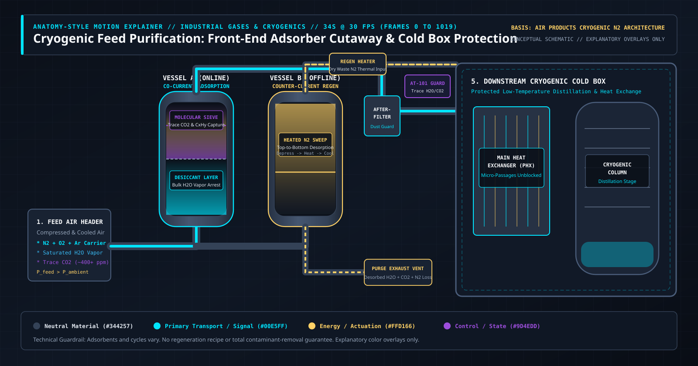

# Why Cryogenic Air Separation Freezes Solid Without Front-End Feed Purification: A 1,020-Frame Code-Driven Anatomy



**BLUF:** A cryogenic nitrogen or air separation plant cannot cool atmospheric air to distillation temperatures until water vapor ($\text{H}_2\text{O}$) and carbon dioxide ($\text{CO}_2$) are stripped upstream. If either compound crosses the cold box boundary, it transitions directly into solid ice or dry-ice frost inside millimeter-scale brazed aluminum heat exchanger passages, restricting flow, degrading heat transfer, and forcing a costly plant warm-up defrost. Front-end purification solves this through alternating dual-vessel adsorption beds that arrest bulk moisture first and trace $\text{CO}_2$ second, while regenerating the offline vessel with dry waste nitrogen returning from the distillation column.

---

## 1. The Engineering Problem: Phase-Change Plugging Before Distillation Begins

Atmospheric air looks clean at ambient temperature, yet every cubic meter of compressed intake air carries water vapor, roughly $400+$ ppm of carbon dioxide, and trace light hydrocarbons. In an on-site cryogenic nitrogen plant, such as the architecture documented by [Air Products for Cryogenic Nitrogen Generation](https://www.airproducts.com/supply-modes/gen-gas-on-site/onsite-nitrogen-generation/cryogenic-nitrogen-plant), the separation of nitrogen from oxygen relies on fractional distillation at cryogenic temperatures approaching $-170^\circ\text{C}$ to $-196^\circ\text{C}$ ($77\text{ K}$ to $103\text{ K}$).

To reach those temperatures economically, incoming compressed air must pass through a Main Heat Exchanger (PHX), typically a brazed aluminum plate-fin heat exchanger containing thousands of serrated micro-passages. Inside those passages, warm feed air cools against returning cold product nitrogen and waste gas streams.

Here is the physical constraint that dictates the entire front-end plant architecture:

1. **Water vapor ($\text{H}_2\text{O}$)** freezes at $0^\circ\text{C}$ ($273.15\text{ K}$). Even after mechanical compression aftercoolers and condensate separators remove liquid water droplets, the air leaves the separator saturated with water vapor at its operating pressure and temperature.
2. **Carbon dioxide ($\text{CO}_2$)** undergoes desublimation (direct vapor-to-solid deposition) at cryogenic temperatures well above the boiling point of nitrogen and oxygen.
3. **Micro-channel vulnerability:** Because plate-fin heat exchangers rely on narrow fin spacing to achieve high thermal effectiveness with minimal temperature approach, solid deposition of either $\text{H}_2\text{O}$ or $\text{CO}_2$ rapidly increases differential pressure ($\Delta P$), starves the distillation column of feed, and requires shutting down the cold box for a full thermal derime.

Front-end feed purification is therefore not an optional polishing step. It is the thermodynamic gatekeeper that makes continuous cryogenic rectification possible.

---

## 2. Why Static P&IDs Fail to Communicate Transient Adsorption Dynamics

If you hand a process Piping and Instrumentation Diagram (P&ID) to a software engineer, technical buyer, or plant operator, Vessel A and Vessel B look like two identical rectangles connected by a ladder of isolation valves. A static diagram obscures the four transient mechanisms that actually govern plant reliability:

1. **Axial selectivity and competitive adsorption:** Why water must be captured in a dedicated lower layer before the gas reaches the upper molecular sieve layer.
2. **The advancing Mass-Transfer Zone (MTZ):** Adsorption is not a uniform filter; it is a moving wave of saturation and local exothermic heat release that travels upward through the packed bed over the cycle.
3. **Causal separation of transport, actuation, and control:** Distinguishing the physical carrier gas path from valve switching energy and trace-contaminant analyzer interlocks.
4. **Counter-current regeneration coupling:** How the cold box and the front-end purifier form a closed loop, using dry low-pressure waste gas from distillation to strip contaminants out of the offline vessel in the reverse flow direction.

To make those mechanisms legible without inventing proprietary vendor geometry or claiming unverified numerical performance gains, we built a deterministic **34-second, 30 fps (1,020-frame, indexed `0–1019`) code-driven motion explainer**.

---

## 3. Visual Architecture & Explanatory Color Grammar

In technical visualization, decorative gradients and literal glowing gasses confuse the reader. In our 1,020-frame canvas engine, every color is strictly bound to an explanatory layer:

| Visual Layer | Hex Token | Engineering Semantics | What It Represents in the Explainer |
| :--- | :--- | :--- | :--- |
| **Technical Stage** | `#0B1019` | High-contrast dark reference plane | Eliminates visual glare and anchors spatial coordinate grids |
| **Neutral Material** | `#344257` | Structural pressure boundaries | Carbon/stainless vessel shells, manifold headers, PHX core, distillation column |
| **Primary Transport** | `#00E5FF` | Carrier gas & purified mass transfer | Compressed feed air header, moisture front, purified $\text{N}_2/\text{O}_2$ conduit to cold box |
| **Energy / Actuation** | `#FFD166` | Thermal duty, work, & valve actuation | Regeneration heater input, counter-current thermal desorption wave, valve actuators, visible losses |
| **Control / State** | `#9D4EDD` | Sequence logic, MTZ guard, & $\text{CO}_2$ arrest | Zeolite $\text{CO}_2$ capture zone, advancing MTZ boundary, `AT-101` trace analyzer interlock |

> **Factual Guardrail:** Colors are explanatory overlays, not literal optical emission. All plots and wave profiles in the explainer represent qualitative physical relationships (concentration fronts and thermal pulses) rather than empirical plant telemetry or a regeneration recipe.

---

## 4. Frame-by-Frame Walkthrough of the 1,020-Frame Motion Timeline

Every frame $f \in [0, 1019]$ in the application is a pure mathematical function `computeFrameState(f)`. Whether you play the timeline at 30 fps or scrub manually to Frame `412`, camera coordinates, isometric yaw, valve states, and particle trajectories resolve deterministically.

### Scene 1: Reveal Upstream Adsorbent Assembly (`Frames 0–149` | `0–5s`)

* **Camera Choreography:** Opens on the full front-end purification skid upstream of the cryogenic cold box boundary, then executes a measured three-quarter perspective push (`zoom: 0.98 -> 1.18`, `isoYaw: 0.0 -> 0.24`) toward the active switching manifold.
* **Mechanism:** Compressed, cooled feed air enters the bottom inlet manifold. Switching valve `V-1A` directs flow into **Vessel A (Online Adsorption)** while `V-1B` isolates **Vessel B (Offline Regeneration)**.
* **Why Two Vessels Are Mandatory:** Fixed-bed adsorption is inherently batch-wise because solid media eventually saturate. Cryogenic distillation, by contrast, requires steady, uninterrupted feed to maintain tray/packing hydraulics and liquid-vapor equilibrium inside the column. Dual switching vessels bridge batch capture with continuous cryogenic operation.

### Scene 2: Selective Water & $\text{CO}_2$ Removal (`Frames 150–299` | `5–10s`)

* **Camera Choreography:** Transitions into a high-magnification sectional close-up (`zoom: 1.62`) of Vessel A's interior packed bed, accompanied by a qualitative axial Mass-Transfer Zone (MTZ) loading inset.
* **Mechanism:** Why not fill the entire vessel with a single molecular sieve zeolite? Polar water molecules bind far more strongly to hydrophilic zeolites than carbon dioxide does. If bulk moisture enters a pure zeolite bed, water displaces previously adsorbed $\text{CO}_2$ (roll-up phenomenon) and imposes a heavy thermal penalty during regeneration.
* **Layered Bed Solution:**
  * **Lower Layer (Moisture-Selective Desiccant):** Activated alumina or silica gel arrests bulk water vapor at the inlet end of the bed.
  * **Upper Layer (Molecular Sieve Zeolite, e.g., 13X/NaX):** Receives predried air and captures trace $\text{CO}_2$ and light hydrocarbons along a sharp advancing Mass-Transfer Zone (`#9D4EDD`).
* **Scale & Rate Notice:** Particle capture and axial front progression are time-compressed and scaled for visual clarity.

### Scene 3: Track the Purified Feed Causal Pathway (`Frames 300–509` | `10–17s`)

* **Camera Choreography:** Tracks upward out of Vessel A's top head, following the purified carrier gas across the top header (`V-2A`), through the particulate after-filter, and past the analyzer interlock into the cold box.
* **Mechanism:** As gas traverses packed desiccant and zeolite beads under pressure cycling and thermal swings, mechanical attrition generates fine dust. A downstream **Particulate After-Filter** captures this dust before it can erode turboexpanders or foul plate-fin heat exchanger channels.
* **Distinct Causal Overlays:**
  * **Primary Transport (`#00E5FF`):** Dry, $\text{CO}_2$-depleted air stream entering the cold box.
  * **Control / State (`#9D4EDD`):** Continuous trace analyzer (`AT-101`) monitoring outlet slip against freeze-out thresholds before the cycle timer commands a vessel switch.
  * **Energy / Actuation (`#FFD166`):** Valve actuator states holding `V-2A` open and `V-2B` closed.

### Scene 4: Separate Regeneration State (`Frames 510–749` | `17–25s`)

* **Camera Choreography:** Pans to **Vessel B** with a reverse three-quarter angle (`isoYaw: -0.12`) and opens a dedicated **Qualitative Regeneration State Inset** tracking the thermal pulse and effluent desorption curve.
* **Mechanism:** Before Vessel A reaches breakthrough, Vessel B must be fully restored and repressurized. Regeneration proceeds through four sequential sub-states:
  1. **Depressurization (Blowdown):** Vessel B vents from operating feed pressure down to near-atmospheric pressure.
  2. **Thermal Desorption Sweep (TSA) / Purge:** Dry, low-pressure waste nitrogen returning from the cold box is routed through a **Regeneration Heater (`#FFD166`)** and swept **counter-currently (top-to-bottom)** through Vessel B. Flowing top-to-bottom ensures that moisture desorbed from the bottom layer is pushed directly out the bottom vent (`V-3B`) without ever migrating through and hydrothermal-aging the sensitive upper molecular sieve layer.
  3. **Cooling Sweep:** Unheated dry waste gas continues flowing top-to-bottom to remove stored sensible heat from the bed; a hot bed switched online would spike outlet temperatures and suffer reduced adsorption capacity.
  4. **Repressurization:** Vessel B slowly equalizes back to feed pressure so switching does not send a pressure shockwave into the cold box.
* **Technical Limit:** Adsorbent selection, cycle type (TSA, PSA, or hybrid PTSA), heater temperatures, and step durations vary by plant size and vendor; no regeneration recipe is prescribed.

### Scene 5: Protect Downstream Cryogenic Equipment (`Frames 750–1019` | `25–34s`)

* **Camera Choreography:** Pulls back to a stable, full-system overview (`zoom: 1.0`, `isoYaw: 0.0`) uniting the upstream purification skid, the regeneration return loop, the cold box **Main Heat Exchanger (PHX)**, the **Cryogenic Distillation Column**, and the **System Losses & Irreversibility Ledger**.
* **Mechanism:** Purified air enters the warm end of the brazed aluminum plate-fin heat exchanger, cools to cryogenic conditions without solid deposition, and enters the rectification column where high-purity nitrogen product separates from oxygen-enriched waste gas.
* **Retaining Visible Losses, Limits, and Uncertainty:** A credible engineering schematic never pretends efficiency is $100\%$. Scene 5 explicitly retains four real-world penalties:
  * **Hydraulic Loss ($\Delta P$):** Frictional pressure drop across packed beds and dust filters requires additional main air compressor shaft work.
  * **Thermal Regeneration Duty:** Electrical or steam energy consumed by the regeneration heater.
  * **Purge & Blowdown Gas Loss:** A fraction of separated dry gas and depressurization inventory is exhausted to the atmosphere to carry away desorbed $\text{H}_2\text{O}$ and $\text{CO}_2$.
  * **Adsorbent Aging & Slip Risk:** Hydrothermal cycling, inlet oil/liquid carryover, or flow maldistribution gradually degrades sieve capacity, meaning total contaminant removal is never unconditionally guaranteed.

---

## 5. How the Deterministic Canvas Engine Works Under the Hood

For engineering and developer-writers building interactive technical explainers, the core architectural rule is simple: **decouple frame state math from imperative rendering**.

Instead of relying on stateful CSS timers that drift when a user switches browser tabs, our timeline computes a complete `FrameState` snapshot from the integer frame index `0..1019`:

```typescript
export function computeFrameState(rawFrame: number): FrameState {
  const frame = Math.max(0, Math.min(1019, Math.floor(rawFrame)))
  const timeSec = frame / 30 // Locked 30 fps timebase
  const scene = getSceneForFrame(frame)
  // Camera interpolation via smoothstep(edge0, edge1, frame)
  // Qualitative bed saturation & regeneration wave positions derived purely from frame
  return { frame, timeSec, progress: frame / 1019, scene, camera, qualitativeMetrics }
}
```

This functional architecture delivers three practical advantages:

1. **Frame-Exact Scrubbing:** Dragging the scrubber to Frame `150` or Frame `750` produces the exact same particle positions, MTZ front height, and camera matrix every time.
2. **Independent Layer Filtering:** Users can toggle `Transport (#00E5FF)`, `Energy/Actuation (#FFD166)`, `Control/State (#9D4EDD)`, `Bed Cutaway`, and `Losses Ledger` on or off at any frame without mutating playback state.
3. **Zero-Reflow GPU Execution:** All schematic geometry, callout leader lines, and qualitative plots render on a single DPR-scaled HTML5 `<canvas>`, eliminating DOM layout thrashing during 30 fps playback.

---

## 6. Frequently Asked Questions (AEO / Technical Reference)

### Why is water removed before carbon dioxide in a cryogenic air purifier?
Water vapor has a high polarity and strong affinity for molecular sieve zeolites. If bulk moisture reaches the molecular sieve zone, it competitively displaces adsorbed $\text{CO}_2$ and requires higher thermal energy to desorb. Placing a moisture-selective desiccant layer (such as activated alumina) upstream at the bottom of the bed captures bulk water first, reserving the upper molecular sieve layer for trace $\text{CO}_2$ and hydrocarbons.

### Why does adsorber regeneration flow top-to-bottom (counter-current) when adsorption flows bottom-to-top?
During normal adsorption, water is trapped near the bottom inlet and $\text{CO}_2$ is trapped higher in the bed. Flowing heated regeneration gas counter-currently from top to bottom pushes desorbed $\text{CO}_2$ and moisture out through the bottom inlet manifold without driving concentrated water vapor upward through the moisture-sensitive molecular sieve layer.

### What happens if carbon dioxide slips past the front-end purifier into the cold box?
At cryogenic distillation temperatures, $\text{CO}_2$ desublimates directly into solid dry ice inside the narrow channels of the brazed aluminum main heat exchanger or distillation column passages. Accumulation increases pressure drop, reduces thermal performance, and eventually forces a plant shutdown and warm-up defrost (derime).

---

## 7. Scope, Reference Basis, and Disclaimers

* **Mechanism Reference:** [Air Products — Cryogenic Nitrogen Plant Architecture](https://www.airproducts.com/supply-modes/gen-gas-on-site/onsite-nitrogen-generation/cryogenic-nitrogen-plant).
* **Reference Scope:** The reference supports the underlying industrial process and front-end purification role upstream of a cryogenic cold box. Camera moves, color palette (`#0B1019`, `#344257`, `#00E5FF`, `#FFD166`, `#9D4EDD`), sectional cutaways, and 1,020-frame timing are original illustrative directions, not experimentally validated observations or vendor shop drawings.
* **Safety & Operational Notice:** Adsorbents and cycles vary across installations. This article and companion interactive software provide a conceptual engineering overview, not a certified design, simulation result, regeneration recipe, total contaminant-removal guarantee, or operational instruction for hazardous pressurized or cryogenic equipment.
